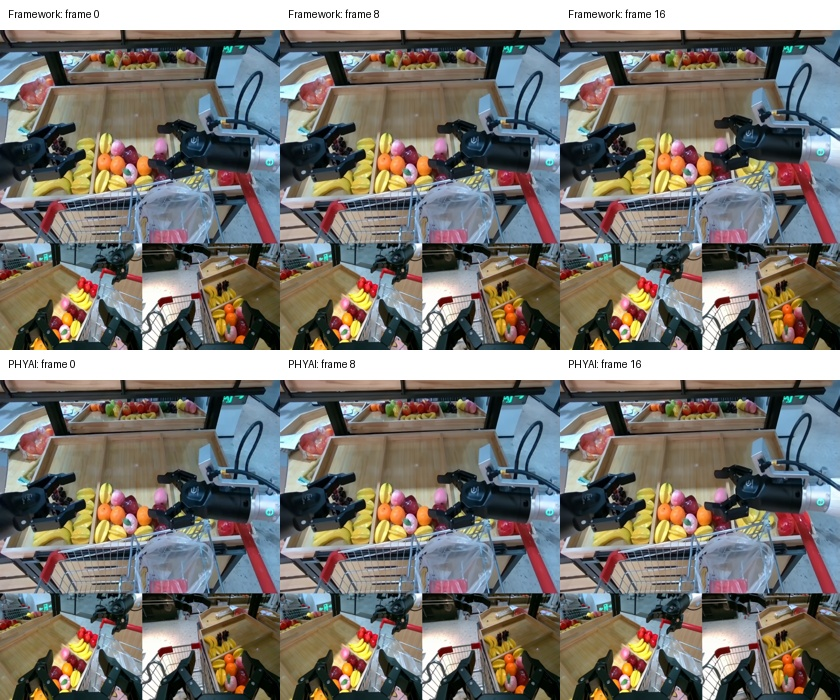

# Cosmos3 staged inference

[中文](README_ZH.md)

## Cosmos3-Nano + AgiBot

Generate one video chunk from an AgiBot observation and 16 supplied actions, using
the prompt "Pickup items in the supermarket". The sample inputs are in [assets](assets/).

Use a local **Cosmos3-Nano** checkpoint with `transformer/`, `vae/`, and
`text_tokenizer/`. From the repository root, run:

```bash
CUDA_VISIBLE_DEVICES=0 uv run python examples/cosmos3/run_cosmos3_staged.py \
    --checkpoint /path/to/Cosmos3-Nano \
    --sample examples/cosmos3/assets/agibot_forward_dynamics.json \
    --offload \
    --output .cache/cosmos3/agibot.pt
```

The demo runs VLM → VAE encoder → DiT → VAE decoder on one GPU. `--offload` moves
each stage's weights to CPU after use; text K/V stay on GPU.

The output is `.cache/cosmos3/agibot.mp4` (17 frames, 560×640, 10 FPS) and
`agibot.pt` (video, latents, and supplied actions). The bundled sample uses the
first action chunk, 30 denoising steps, guidance 1, and seed 0.

## Customized inputs

Omit `--sample` to use [customized_inputs.py](customized_inputs.py). It generates
synthetic observations and state: six visual streams and 49 state/action tokens,
totaling 583 GEN tokens. This workload is for testing the API and performance.

```bash
CUDA_VISIBLE_DEVICES=0 uv run python examples/cosmos3/run_cosmos3_staged.py \
    --checkpoint /path/to/Cosmos3-Nano-Policy-DROID \
    --steps 10 --seed 9000 \
    --warmup 3 --repeat 10 --offload \
    --output .cache/cosmos3/customized.pt
```

This saves `customized.pt` and `customized.mp4` under `.cache/cosmos3/`.
Add `--latent-input` to use synthetic latents and skip the VAE encoder; VLM, DiT,
and VAE decoder still run.

## Read the timings

Choose an idle GPU for timing. Each stage prints `run mean`, `median`, and `min`
in milliseconds after `--warmup` runs, over `--repeat` measured runs:

| Log stage | What is measured |
| --- | --- |
| `vlm` | Text prefill |
| `vae_encode` | All input VAE encodes for the request |
| `dit` | One complete denoising loop: 10 steps in the customized command |
| `vae_decode` | Decoding the output video |

For DiT latency, read `Cosmos3 dit: run mean=... ms`; it excludes VLM and VAE.
`weight load` and `offload` are separate. Warmup, preprocessing outside the
stages, and file saving are excluded from `run`, so adding stage times does not
give the full program latency.

CUDA Graph is enabled by default. A capture log such as `warmup=1 measured=0`
means a graph was captured during warmup and no new graph was captured while
timing. Add `--no-cuda-graph` to the same command for an eager comparison.

## AgiBot frame comparison

Frames 0, 8, and 16: Cosmos Framework on top, PHYAI below. With the same checkpoint
and inputs, decoded video PSNR is 49.03 dB.


