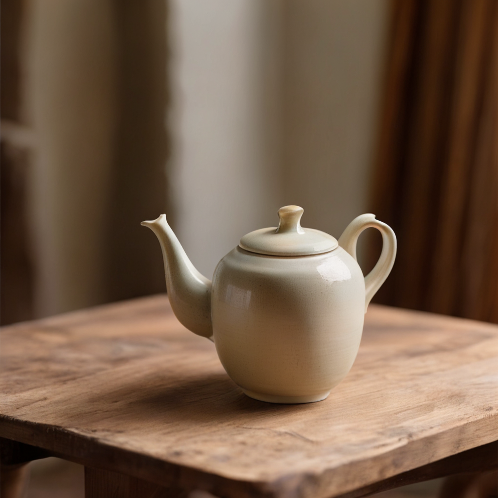
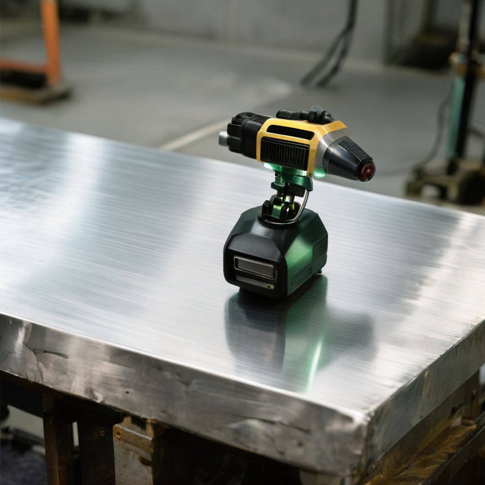
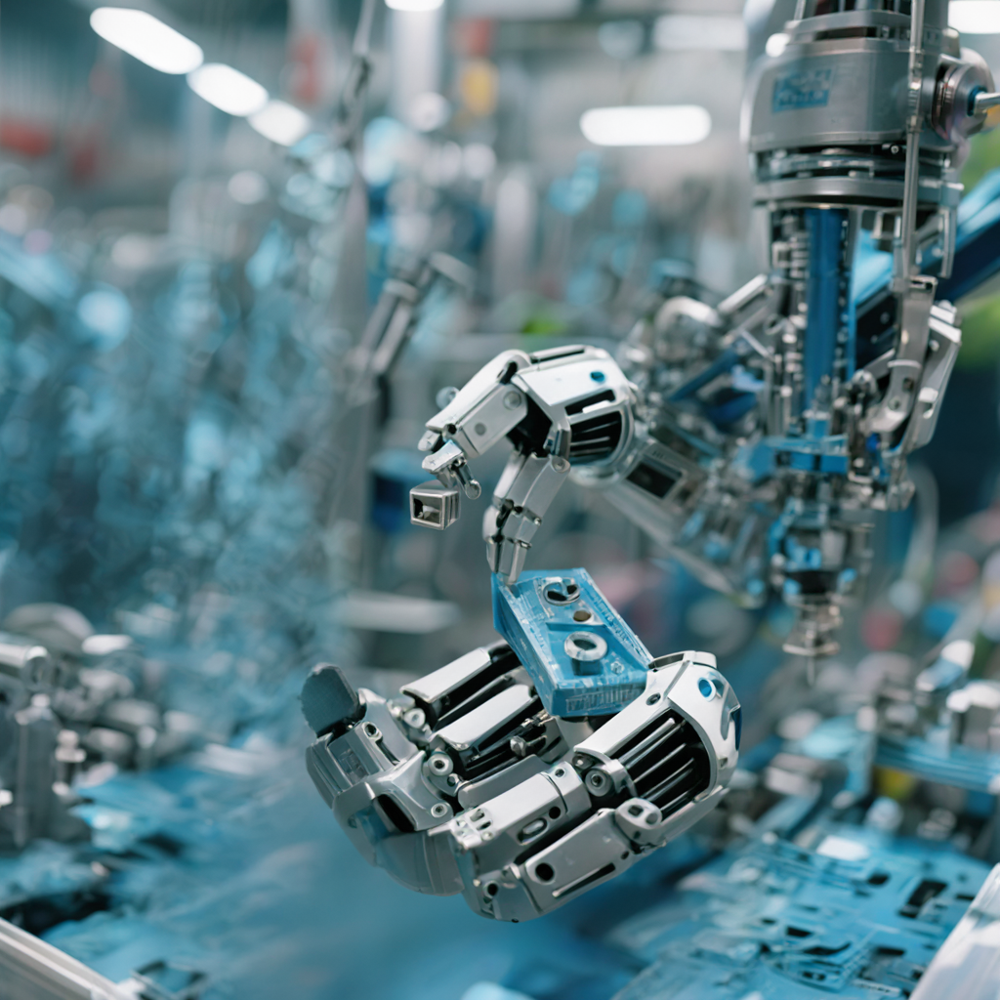

# Xiaomi U0 text-to-image

Generate a 1024 × 1024 image from a text prompt with Xiaomi-Robotics-U0-4B. PhyAI runs both the autoregressive model and the Emu3.5 image decoder. Token generation uses BF16 and FlashInfer paged attention; image decoding uses the released FP32 weights.

You need one CUDA GPU, the repository runtime, and two local checkpoints:

- `Xiaomi-Robotics-U0-4B`, containing model weights, `config.json`, `unis.tiktoken`, and `unis_vision_tokens.txt`.
- `Emu3.5-VisionTokenizer`, containing model weights and `config.json`. PhyAI reads these files directly to load the decoder.

See the [full guide](../../docs/models/xiaomi-u0/text-to-image.mdx) for the inference flow and output format.

## Install

From the repository root:

```bash
uv lock
uv sync --locked
```

`phyai-utils-tools` installs `tiktoken` as a regular dependency. If you already have a working environment, preview the install plan with `uv sync --locked --dry-run`.

## Generate an image

Check GPU availability with `nvidia-smi`, then run:

```bash
PHYAI_FLASHINFER_WORKSPACE_BYTES=536870912 \
uv run --locked python examples/xiaomi_u0/run_xiaomi_u0.py \
  --checkpoint-dir /path/to/Xiaomi-Robotics-U0-4B \
  --vision-tokenizer-dir /path/to/Emu3.5-VisionTokenizer \
  --prompt "A studio photograph of a ceramic teapot on a wooden table." \
  --output-dir ./outputs/u0-teapot \
  --seed 42 \
  --max-new-tokens 4169
```

The 512 MiB FlashInfer workspace is needed when planning the full sequence; the default 128 MiB workspace is too small for this configuration. The workspace uses GPU memory alongside the model and KV caches.

Use an empty output directory. The script saves the generated tokens to `generated_ids.npy` and the decoded image to `image.png`. It also saves the input tokens and records the stop reason, token count, image size, and timings in `generation.json`. It closes the AR engine before loading the image decoder to release GPU memory between stages.

To inspect prompt tokenization without loading either model:

```bash
uv run --locked python examples/xiaomi_u0/run_xiaomi_u0.py \
  --checkpoint-dir /path/to/Xiaomi-Robotics-U0-4B \
  --prompt "A compact industrial inspection camera on a brushed steel workbench, precise studio lighting." \
  --output-dir ./outputs/u0-prepare \
  --prepare-only
```

## Generated examples

These images were generated on Thor with seed 42, using FlashInfer and the native PhyAI decoder.

### Ceramic teapot

Prompt: A studio photograph of a ceramic teapot on a wooden table.



### Inspection camera

Prompt: A compact industrial inspection camera on a brushed steel workbench, precise studio lighting.



### Robotic gripper

Prompt: A robotic gripper holding a small metal component on an assembly line, realistic industrial photography.



To reproduce the camera or gripper, use its prompt in the generation command above and choose a new `--output-dir`.

## Supported configuration

Each request generates one image from a fixed 64 × 64 code grid, using no-text classifier-free guidance at scale 3. Run with CUDA Graph disabled. The example does not support concurrent requests, video, or other output sizes.

## Validation

On Thor, the native decoder passed a numerical comparison with the released decoder for one saved code grid. Each of the three prompts above produced a 1024 × 1024 image with seed 42, using FlashInfer and the native decoder.

See the [full guide](../../docs/models/xiaomi-u0/text-to-image.mdx#validation) for a validation summary and links to the comparison results.
